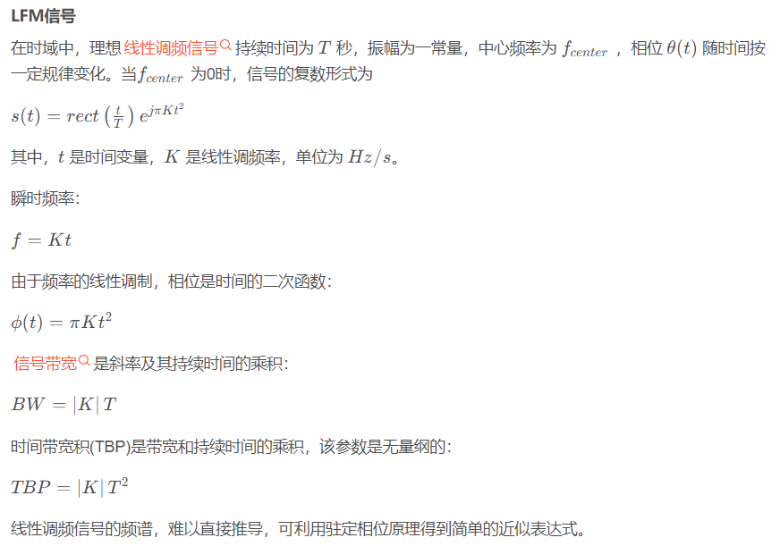
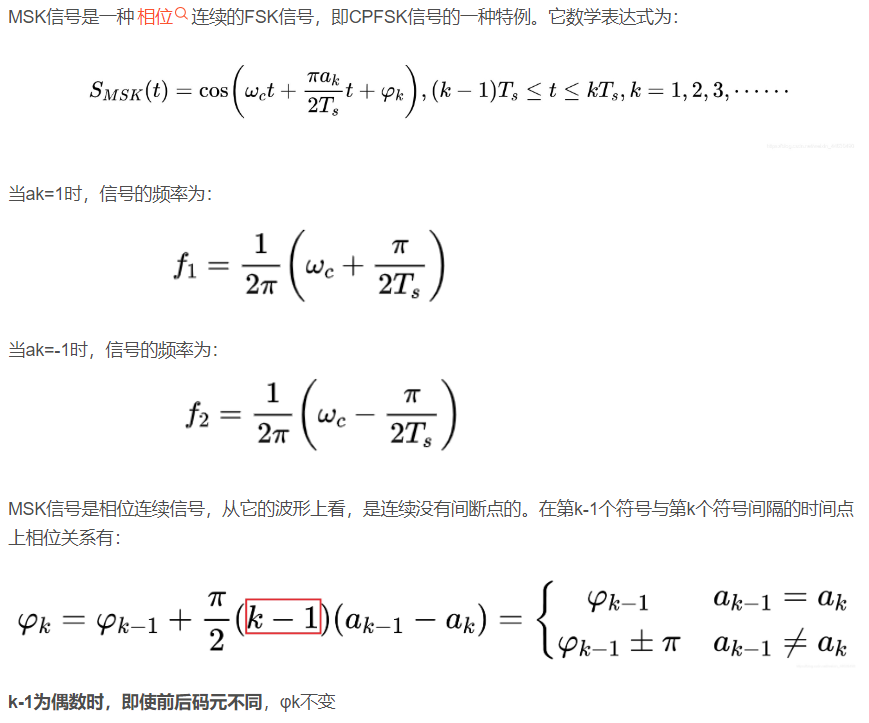
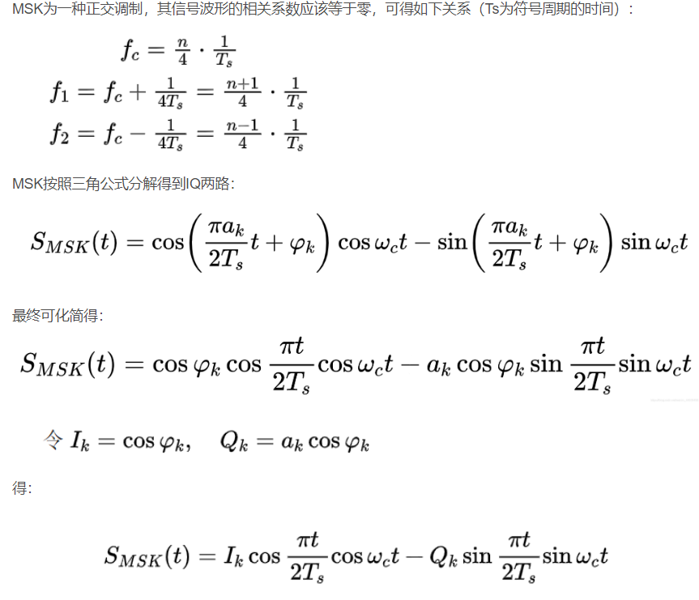
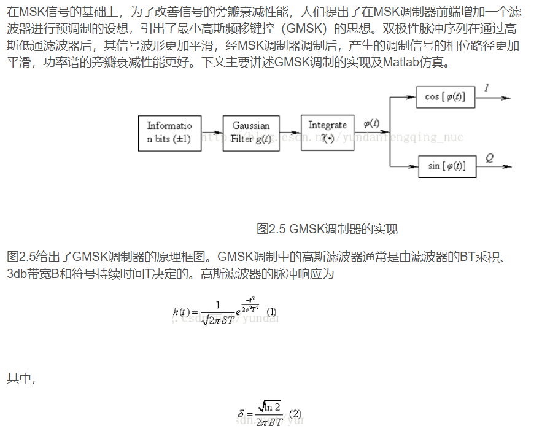
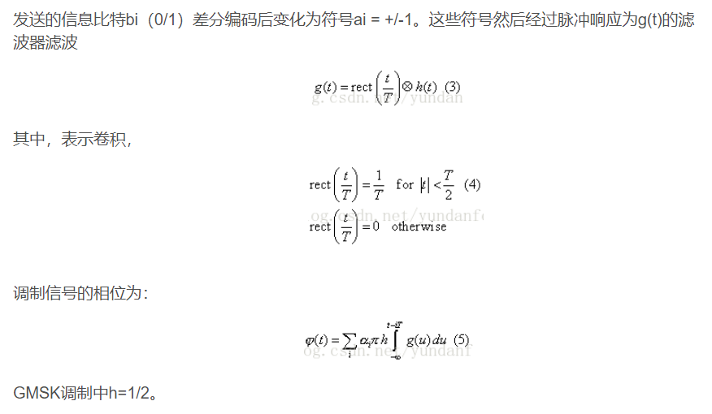
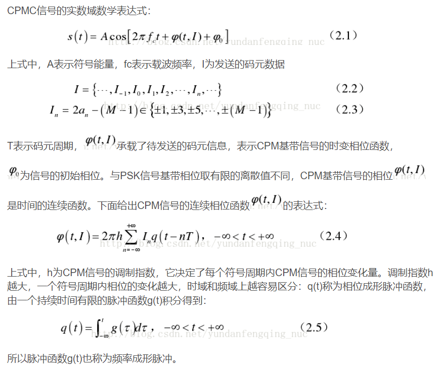
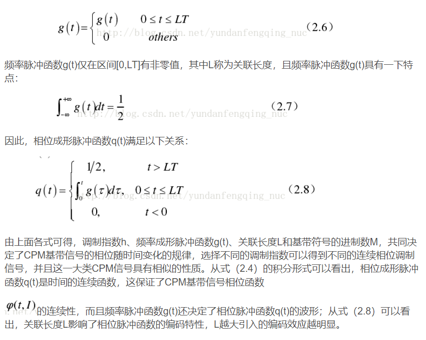
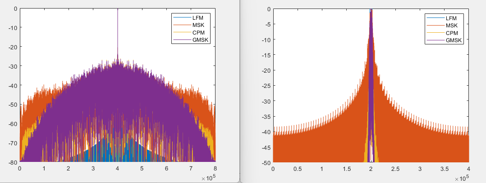

# Integrated Radar Communication - LFM, CPM-LFM, MSK-LFM, GMSK-LFM Signals [with MATLAB Code]

MSK modulation  
GMSK modulation  
CPM modulation  
Integrated signal simulation fuzzy function

## Images

<!-- PAYMENT_BLOCK -->

## Get this dataset

- Payment link (Stripe): [Buy now](https://buy.stripe.com/3cs8yP7sY87d0vu9AB)
- Payment QR code: 

<!-- /PAYMENT_BLOCK -->
